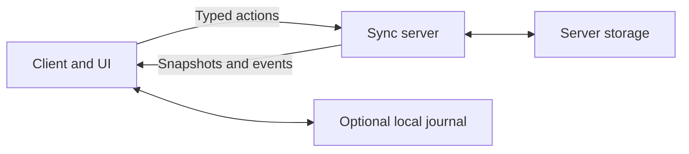

A **source** is a shared entity, such as a board or counter. Your contract defines
its state and actions; one server authority decides which changes are accepted.

## Define, handle, reduce

| You write                                         | Sync handles                                 |
| ------------------------------------------------- | -------------------------------------------- |
| `Source.make` schemas and actions                 | Encoding, validation, and typed calls        |
| `Server.make` authorization and handlers          | Atomic commits, receipts, and ordered replay |
| `Client.definition` event and optimistic reducers | Connections, local views, and recovery       |

The [getting started example](./getting-started.md) connects these three pieces.
Applications also own authentication, UI, and external side effects.

## Optimism and retries

An optimistic reducer shows an edit immediately. The server's events replace
that prediction; a declared rejection removes it.

Each command keeps its identity through retries. If `set(7)` commits but its
response is lost, retrying returns the recorded result instead of applying a new
edit. The [client guide](../client.mdx#retry-and-recovery) shows this exchange.

After reconnecting, clients catch up from ordered events or a fresh snapshot.
Presence and other ephemeral messages are separate: they can be missed and never
enter the durable history.

## Two kinds of storage

**Server storage** holds authoritative state and command receipts. Use an adapter
or provide `SourceStorage` for a portable `Server.host`.

**Client persistence** retains pending edits across reloads. A cached snapshot is
only a starting view; the server confirms current state. Keep the pending-command
journal when repairing a cache or changing storage, so unresolved edits can be
reconciled. See [persistence](../client.mdx#persistence) for browser setup.
