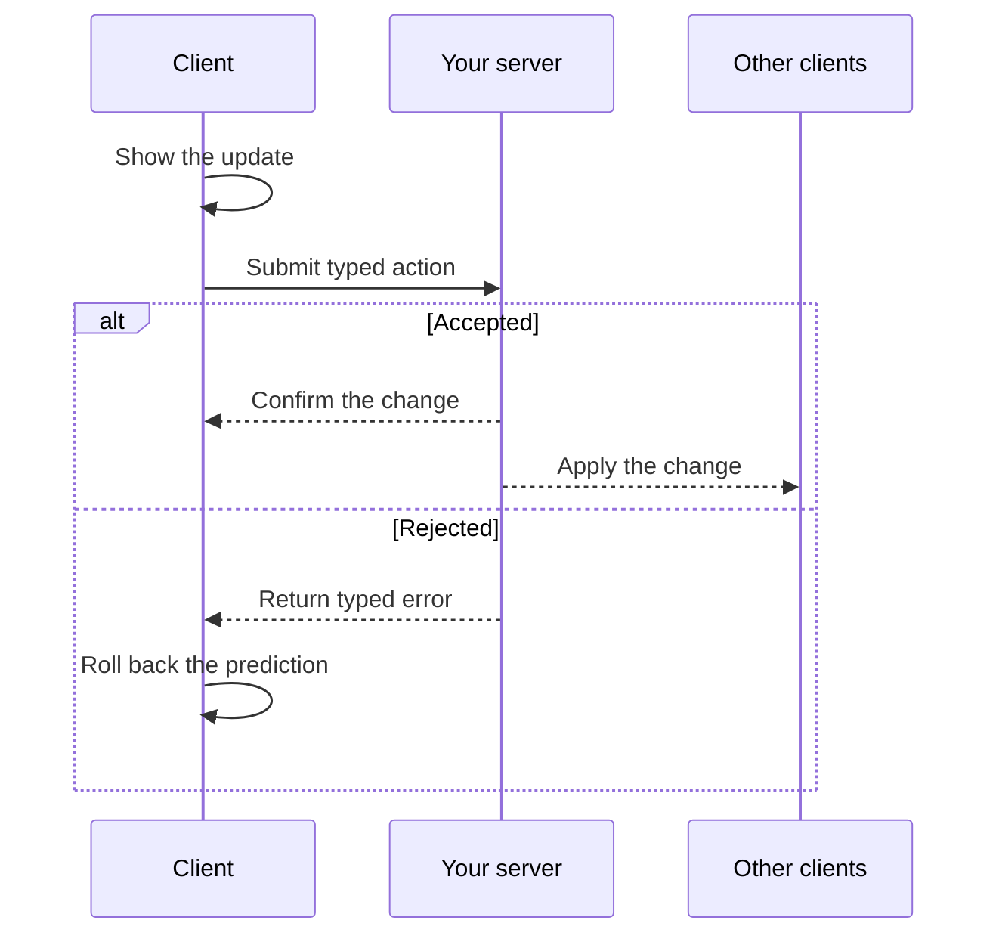

Sync is a real-time state library for Effect. Build shared boards, admin tools,
and other interactive apps where edits appear immediately and changes reach
every connected client.

You define the data and actions, implement the server rules, and connect the UI.
Sync handles version tracking, optimistic updates, retries, rollbacks, and
reconnect recovery for you.

## Keep the API typed from server to UI

Define your state, action payloads, results, and errors with Effect Schema. Sync
derives the client and server types from that contract and validates data as it
crosses the network.

Here is a persistent browser client for the
[counter contract](./getting-started.md#define-a-source):

```ts title="counter-atoms.ts"
import { IndexedDb } from "@yielded/sync-local-indexeddb";
import { BrowserSource } from "@yielded/sync-platform-browser";
import { Client } from "@yielded/sync/client";

import { Counter, CounterId } from "./counter";

const CounterClient = Client.definition(Counter, {
  applyEvent: (_snapshot, event) => ({ value: event.value }),
  optimistic: {
    set: (_snapshot, payload) => ({ value: payload.value }),
  },
});

export const counter = BrowserSource.bind(CounterClient, {
  id: CounterId.make("demo"),
  actorId: "alice",
  persistence: IndexedDb.layer({ namespace: "counter" }),
});
```

React reads `counter.replica` and dispatches `counter.action.set`, both typed from
`Counter`. Use the signed-in actor's ID; the server authenticates the connection.

## Show edits immediately

Your optimistic reducer updates the UI before the server replies. The server
still runs your authorization and business rules:



## Recover interrupted work

Sync keeps an edit's identity through automatic retries. If a response is lost,
it looks up the saved result before resending the same command. A confirmed edit
isn't applied twice.

Versioned updates let clients catch up after reconnecting; a fresh snapshot
repairs gaps in retained history. IndexedDB keeps pending edits across reloads,
and schema version checks catch incompatible data.

If a result can no longer be confirmed, Sync preserves the edit for your app to
resolve. [Recovery controls](../client.mdx#retry-and-recovery) expose that work to
your UI.

## Use your own application stack

Server handlers and client workflows are Effects, so database access,
permissions, logging, and errors compose with the rest of your application.

Start with the Cloudflare and IndexedDB adapters, or provide your own storage
and transport. Your app owns its data, authentication, conflict rules, and
schema migrations.

[Build a synced counter](./getting-started.md) or explore the
[complete board example](https://github.com/yielded-dev/sync/tree/main/examples/list-board).
